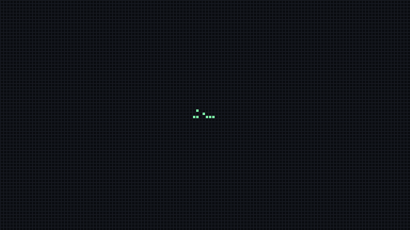

# still-life

### A YouTube video that dies when its universe gets stuck in a loop.

**[▶ The video](https://www.youtube.com/watch?v=oFWeLMe4bhI)** · **[Watch it live](https://davidackerman.github.io/still-life/)** · [The Short](https://youtube.com/shorts/m-JcepjW41U) · [How it lives and dies](#how-it-lives-and-dies)

**Every comment changes this universe. Some save it. Some kill it.**

- 🧬 **A real Game of Life**, running around the clock: 128×72 cells on a torus, one generation every 2 minutes, from a 7-cell acorn.
- 💬 **Every comment adds cells.** `glider 40,20 ne`, `acorn 64,30 red`, or just say anything, and add a color if you like. Replies count, and so do comments on the Shorts and messages in the live chat.
- ⏳ **The video updates itself.** Its title counts down to its own death ("dies in 8d 21h 30m if nobody comments") and its thumbnail is the universe.
- 🔁 **Left alone, it always gets stuck.** A finite universe must eventually repeat a state, and then it loops forever. That starts a 24-hour countdown.
- ⚫ **If nobody breaks the loop, it dies.** An obituary video replays its life, the video goes private, and a bigger universe is born on the obituary.
- 🔍 **Nothing to trust.** Every run is in a hash-chained public log; anyone can replay the whole life from the seed and check it.

No server: a Python bot on GitHub Actions wakes every minute while people are commenting (every 3–5 minutes when it's quiet), steps the universe, reads the live chat (and every ~5 minutes the comments) and rewrites the video. The [live page](https://davidackerman.github.io/still-life/) computes the same universe in your browser, forecasts when it gets stuck, and rewinds through its whole life (`?gen=1234` links to a moment).

**Status:** live since November 8, 2026. The death sequence is built and rehearsed, and runs in dry-run mode for now.

## How to play

Comment on [the video](https://www.youtube.com/watch?v=oFWeLMe4bhI) or any of its Shorts, reply to any comment there, or type in [the live stream's chat](https://www.youtube.com/channel/UCh9o5dGhiczNcq29QsRZ6pg/live). The first command in your message wins:

| Comment | Adds |
|---|---|
| `glider x,y [ne\|nw\|se\|sw]` | a glider heading that way (default `se`) |
| `block x,y` · `blinker x,y` · `rpent x,y` · `acorn x,y` | that pattern, its top-left corner at (x, y) |
| `cells x,y x,y …` | up to 25 single cells |
| a pattern's name on its own: `block`, `glider ne`, `acorn` | that pattern, at a spot picked from your comment |
| anything else | a 5×5 random patch made from your comment |
| add `red`, `orange`, `yellow`, `blue`, `purple`, `pink` or `cyan` | your cells in that color, on the live stream and in the Shorts |

`x` is 0–127 and `y` is 0–71, from the top-left; patterns wrap around the edges. Comment as often as you like: up to 3 moves per person count each generation (every 2 minutes), and the rest are skipped. The bot checks every few minutes and lands each move at the generation you posted it. Cells are only ever added, and deleting a comment doesn't undo it.

A color is only paint: the game plays out exactly the same with or without it. Painted cells keep their color as they move, and a newborn cell takes the color most of its three parents have, so a colored glider stays colored as it flies.

## How it lives and dies

One generation every 2 minutes, around the clock.

- **ALIVE**: evolving. The title counts down to when it would get stuck if nobody commented.
- **Stuck in a loop**: it has repeated a state, which a finite universe left alone always eventually does. A 24-hour countdown starts.
- **A comment broke the loop**: it can't die until the deadline. Still changing then? It lives. Back in a loop? It dies (a *new* loop restarts the 24 hours).
- **DIED**: an obituary video replays its life, this video and its Shorts go private, and a bigger universe is born on the obituary.

## Nothing to trust

Every run is in a hash-chained public log ([`state/log.jsonl`](state/log.jsonl)); `python replay.py` rebuilds the whole life from the seed and checks it. The log holds game data only: comment text, IDs and channels are never stored ([privacy](https://davidackerman.github.io/still-life/privacy.html)).

## Running it

Setup, the bot's moving parts and the file map: [SETUP.md](SETUP.md).
